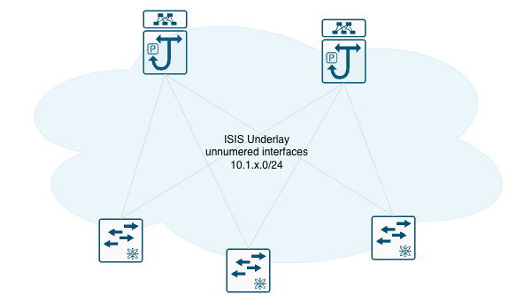

# About the project 

This project is part of notes I've been done to document my progress on Cisco's Data center pespective.Feel free to check not only Data Center topics but also  my journey about CCIE EI completed in 2023.

[Medium Profile: CC1E0x108D4](https://rafaesil.medium.com/)


Addition to protocol and lab notes, like the first part of [VXLAN Flood & Learning article](https://rafaesil.medium.com/dc-journey-day-6-vxlan-flood-and-learn-on-nx-os-be3b25c9c381?sharedUserId=rafaesil). I will share my VXLAN BGP EVPN deployment plus IaC using ansible that's automation tool I'm gooing deeper.

# VXLAN-BGP-EVPN-BASEDonN9K

## Essentials files and Automation proposal scheme


```
.                                              
├── Docker                                     # Folder housing resources for custom container end-hosts used in the CML topology
│   ├── Dockerfile                             # Build instructions for the custom end-host container image
│   └── README.md                              # Instructions on how to build and deploy the Docker end-host images
├── README.md                                  # Main project documentation detailing architecture, topology overview, and usage
├── imagens                                    # Directory storing visual architecture diagrams and screenshots
│   └── BGP-EVPN-VXLAN-BASED_N9k.jpg           # Topology diagram of the VXLAN-EVPN fabric on Cisco Nexus 9Ks
├── knowlegment                                # Folder for capturing study notes, design decisions, and protocol deep-dives
│   └── VXLAN BGP EVPN.md                      # Personal study notes and technical documentation for DCCOR exam prep
└── network-automation                         # Root directory containing all NetDevOps and infrastructure-as-code files
    └── ansible                                # Base directory for the Ansible automation engine
        ├── ansible.cfg                        # Ansible global configuration settings (timeouts, SSH plugins, inventory defaults)
        ├── inventory                          # Directory containing target device definitions and hierarchical variables
        │   ├── group_vars                     # Folder for variables shared across specific groups of devices
        │   │   ├── leaves.yaml                # Global variables applied to all leaf switches (ASNs, common routing parameters)
        │   │   ├── spines.yaml                # Global variables applied to all spine switches (Route reflector settings, spine ASNs)
        │   │   └── vpc_leaves.yaml            # Shared parameters for vPC domain pairs (Domain ID, peer-keepalive settings)
        │   ├── host_vars                      # Folder for device-specific unique variables (loopback IPs, interface mappings)
        │   │   ├── borderleaf1-rio.edc.yml    # Unique variables for external/border leaf 1
        │   │   ├── borderleaf2-rio.edc.yml    # Unique variables for external/border leaf 2
        │   │   ├── leaf1-rio.dc.yml           # Unique variables for standalone leaf 1
        │   │   ├── leaf2-rio.dc.yml           # Unique variables for standalone leaf 2
        │   │   ├── leaf3_vpc-rio.dc.yml       # Unique variables for vPC leaf 3 (peer-link bindings, unique VTEP IPs)
        │   │   ├── leaf4_vpc-rio.dc.yml       # Unique variables for vPC leaf 4 (peer-link bindings, unique VTEP IPs)
        │   │   ├── spine1-rio.dc.yml          # Unique variables for spine 1 (router ID, underlay IP assignments)
        │   │   └── spine2-rio.dc.yml          # Unique variables for spine 2 (router ID, underlay IP assignments)
        │   └── prod.yml                       # Main inventory file mapping CML device IP addresses to their respective roles and groups
        ├── playbooks                          # Directory housing the sequential execution workflow scripts
        │   ├── 01_deploy_underlay.yml         # Playbook to configure physical interfaces, loopbacks, and underlay routing (OSPF/ISIS)
        │   ├── 02_deploy_overrlay.yml         # Playbook to configure MP-BGP EVPN control plane and NVE VTEP mappings
        │   └── 03_deploy_tenant.yml           # Playbook to provision end-user VLANs, VRFs, and tenant bridge domains
        ├── roles                              # Directory reserved for reusable Ansible roles (optional for future refactoring)
        └── templates                          # Directory storing Jinja2 text templates used to generate switch configurations
            ├── border_leaf_config.j2          # Jinja2 template tailored for border leaves connecting to external networks
            ├── leaf_config.j2                 # Jinja2 template tailored for standard and vPC leaf switches
            └── spine_config.j2                # Jinja2 template tailored for spine switches acting as route reflectors

```

## Network Topology



| VRF | L3 VNI | VLAN | VNI | Networks / IPs | Description / Interfaces |
| :--- | :--- | :---: | :---: | :--- | :--- |
| **Default**| — | — | — | IPv4: `10.1.X.0/24` | Underlay Network: ISIS + EVPN VTEP IP |
| **EDGE** | `EDGE_VRF_L3_VNI` | 900 | 900 | TBD | BordService leaf (eBGP with Routers. Leaking routing between Tenants and outside world) |
| **K8s** | `K8S_VRF_L3_VNI` | 100 | 11100 | VLANs 10x<br>IPv4: `10.10x.0.0/24` | Docker network: `rede_vxlan_bond_vlan10x` |
| **COMPUTE** | `COMPUTE_VRF_L3_VNI` | 200 | 22200 | VLANs 20x<br>IPv4: `10.20x.0.0/24` | UCS Server physical Bond0 interfaces |
| **MANAGEMENT**| — | — | — | IPv4: `192.0.2.0/24` | Mgmt interfaces |
| **Addtional Tenants**| — | — | — | IPv4: `TBD` | Additional Tenants |

