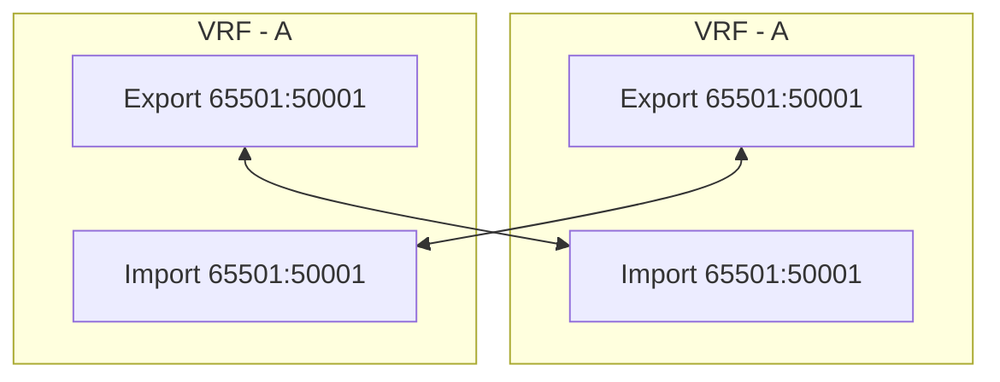

# VXLAN BGP EVPN

## VXLAN Introduction

Network Virtualization conception includes **Location and Identity**

* Identity identifies an end host (IP address, MAC address, and so on);
* Location identifies  the tunnel edge device who Encap/Decap tunnel traffic.

Outer header of the overlay references the Source and Destination locations (VTEPs in VXLAN context)

With MP-BGP EVPN in control plane, the number of flood for discovery in network could be drastically reduced or totally eliminated is some cases (no silent hosts) . EVPN Family allows data structure like host MAC, IP, Network, VRF and VTEP information to be carried over its messages.

MP-BGP l2vpn evpn can be based on iBGP which requires full-mesh making Router Reflector being deployed. eBGP RR is not required but when BGP speaker receives a update from a peer and advertises to another, next-hop will be changed to itself like next-hopself feature.

To be multi tenancy, BGP uses Route Disguishers. The rule of thumb is to use a unique RD on a per-VRF.

_Note: Value of the L2VNI and L3VNI cannot overlap. The same is true for Route Target configuration_

Type of and formats for RD:

|   |   |   |
|---|---|---|
|Type 0|2-bytes ASN|4-byte Value|
|Type 1|4-byte IP |2-byte value|
|Type 2|4-byte ASN| 2-byte value| 

In addition to apply a unique identifiers for each tenants, router target applies policy which allows or deny route to be imported into a tenant/VRF.

* RD - Used to uniquely identify prefixes in BGP table
* RT -  Controls Import and export of these prefexes like a tag

**Automate RD and RT are supported:**
* **RD**  type 1: Loopback Address:[Interna MAC/IP VRF ID] - RD:10.0.0.71:3

* **RT**: ASN:VNI - RT:65501:50001

_Note: In eBGP as underlay, RTs cannot be auto-generated. ASN may vary on different edge, consequently the eBGP use case requires manual configuration of the Route Targets, and they must match among the respective VTEP. Only scenario where manual configuration of RT is required._

### Route types

| RFC/DRAFT|ROUTE TYPE| Description  | Comment|
|---|---|---|---|
| RFC 7432| 1|Ethernet Auto-discovery (AD) route (Not supported by Cisco)|
|| 2|MAC/IP advertisement route|MAC address and its length is mandatory. Identifies a individual end host reachability|
|| 3|Inclusive multicast ethernet tag route|
|| 4|Ethernet segment routed (Not supported by Cisco)|
|Draft-ietf-bess-evpn-prefix-advertiment|5|IP prefix route| |